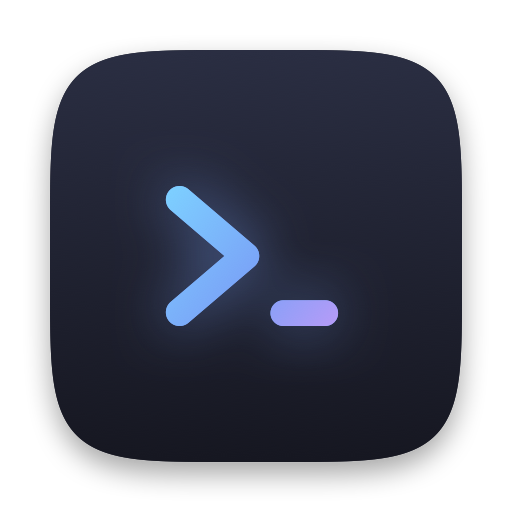

<p align="center"></p>

# macofi

A wofi/rofi-style app launcher for macOS: a borderless, centered panel with fuzzy search,
styled entirely from a config file. Native Swift/AppKit, no dependencies.

## Install

**Homebrew (recommended).** This builds on your Mac, so there's nothing for Gatekeeper to block:

```sh
brew tap l-castel/macofi https://github.com/l-castel/macofi
brew install macofi
brew services start macofi   # background mode with the global hotkey, started at login
```

**Homebrew cask / .dmg.** This installs the prebuilt app into /Applications:

```sh
brew install --cask l-castel/macofi/macofi
```

Or download `Macofi-x.y.z.dmg` from the releases page and drag Macofi to Applications.
Opening Macofi.app from Finder, Spotlight or Login Items starts background mode, and opening it
again shows the picker. Until releases are signed with an Apple Developer ID and notarized, macOS
blocks the first launch. Allow it in System Settings › Privacy & Security › Open Anyway.

**From source** (needs the Xcode Command Line Tools: `xcode-select --install`):

```sh
make install      # ~/Applications/Macofi.app and ~/.local/bin/macofi
make config       # copies config.example.toml to ~/.config/macofi/config.toml
make daemon       # optional: LaunchAgent that runs the background mode at login
```

## Releasing

```sh
echo 0.2.0 > VERSION
make release GITHUB_REPO=you/macofi                            # ad-hoc signed
make release GITHUB_REPO=you/macofi ARCHS="arm64 x86_64" \
  SIGN_IDENTITY="Developer ID Application: …" NOTARY_PROFILE=notary   # signed + notarized
```

This builds `build/dist/` (`.dmg`, `.zip`, source tarball) and writes `Formula/macofi.rb` and
`Casks/macofi.rb` with the right checksums, so the repo itself is the Homebrew tap. Upload
`build/dist/*` to a GitHub release tagged `v0.2.0`, then commit `Formula/` and `Casks/`.

## Usage

| Command | What it does |
|---|---|
| `macofi` | Show the picker, launch the chosen app, exit. Bind it to a key in skhd, AeroSpace, Hammerspoon, etc. |
| `macofi --show` | Ask the running daemon to show its picker (instant). Falls back to one-shot mode if no daemon is running. |
| `macofi --daemon` | Stay resident and toggle the picker with `[daemon] hotkey` (default `alt+space`). `make daemon` installs a LaunchAgent that starts it at login. |
| `pkill -USR1 -x macofi` | Same as the reload hotkey, for scripts. |
| `printf 'a\nb\n' \| macofi --dmenu` | dmenu mode: pick a line from stdin and print it (exit 1 on cancel). |

Keys: type to filter · `↑`/`↓`, `Tab`/`Shift-Tab`, `Ctrl-P`/`Ctrl-N` to move · `Page Up/Down` ·
`Return` to launch · `Esc` or clicking outside to dismiss. Mouse hover, click and scroll work too.

Example AeroSpace binding for one-shot mode:

```toml
[mode.main.binding]
alt-space = 'exec-and-forget ~/.local/bin/macofi'
```

## Configuration

`~/.config/macofi/config.toml` (respects `$XDG_CONFIG_HOME`, or pass `--config PATH`).
Every key is optional. Run `macofi --print-config` to see every option with its default, or read
[`config.example.toml`](config.example.toml). The config is re-read every time the picker opens,
so edits show up without restarting the daemon.

| Section | Keys |
|---|---|
| `[window]` | `width`, `lines`, `border_radius`, `border_width`, `padding`, `shadow`, `opacity`, `vertical_offset`, `close_on_focus_loss` |
| `[input]` | `prompt`, `placeholder`, `separator_width` |
| `[list]` | `show_icons`, `icon_size`, `row_height`, `row_radius`, `row_spacing`, `highlight_matches`, `bold_matches` |
| `[font]` | `family` (`monospace`, `system`, or any installed font), `size`, `input_size`, `weight` |
| `[colors]` | `background`, `foreground`, `border`, `selection_background`, `selection_foreground`, `match`, `placeholder`, `prompt`, `cursor`, `input_background`, `separator` |
| `[search]` | `paths`, `exclude`, `sort_by_usage` |
| `[daemon]` | `hotkey`, `reload_hotkey` |
| `[theme]` | `colors_file` |

### Reloading

Most settings, including `colors_file`, are re-read every time the picker opens. The daemon only
reads the hotkeys and launch history at startup, so press `reload_hotkey` (default `alt+shift+r`)
after changing them. A reload re-reads everything, re-registers both hotkeys and shows a short
message. If the config has problems, the message lists them. If the new `hotkey` can't be
registered, the previous one stays active so the picker never becomes unreachable.
Daemon warnings are also written to `~/Library/Logs/macofi.log`.

Colors accept `#RGB`, `#RRGGBB` or `#RRGGBBAA`. Mistakes such as unknown keys, bad colors or
missing fonts are reported on stderr, and the default is used in their place.

### Wallpaper-based colors (matugen)

`[theme] colors_file` points at a generated file whose `[colors]` section overrides the main
config. Any color it doesn't define falls back to `[colors]`. Because the config is re-read on
every open, a new palette applies the next time the picker appears, with no restart.

```sh
make matugen   # installs the template, registers it with matugen, and enables colors_file
```

which sets this in your config (run `make config` first, or add it by hand):

```toml
[theme]
colors_file = "~/.config/macofi/colors.toml"
```

Every `matugen image …` / `matugen color …` run now also writes `~/.config/macofi/colors.toml`.
To change which Material You roles go where (e.g. a translucent `background`), edit
`~/.config/matugen/templates/macofi-colors.toml`. The same mechanism works with pywal or any
other tool that can render a template.

An Omarchy-style look with sharp corners and no icons:

```toml
[window]
border_radius = 0
[list]
show_icons = false
row_radius = 0
[font]
family = "JetBrainsMono Nerd Font"
[input]
prompt = ">"
```

Launch counts are stored in `~/.local/state/macofi/history.json` and used to rank apps you
open often higher.

## License

MIT, see [LICENSE](LICENSE).
